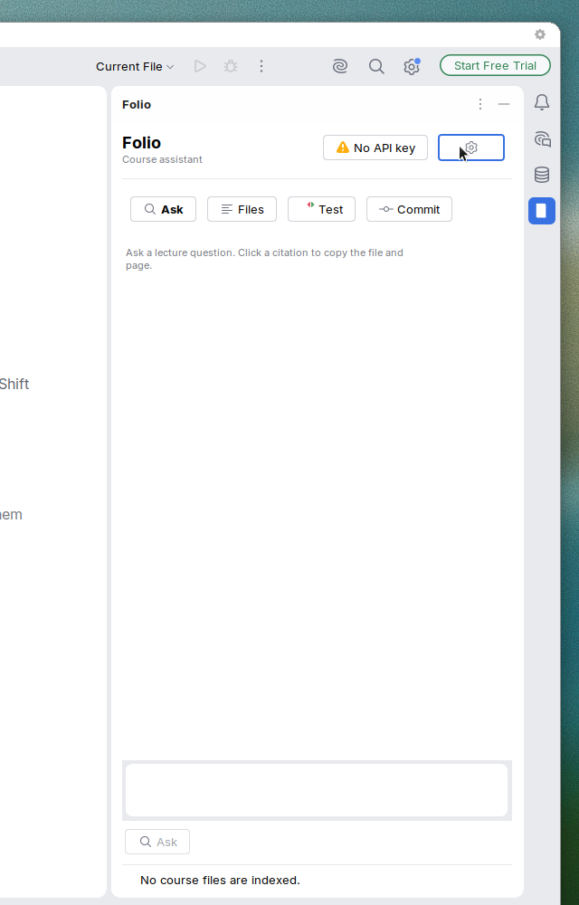
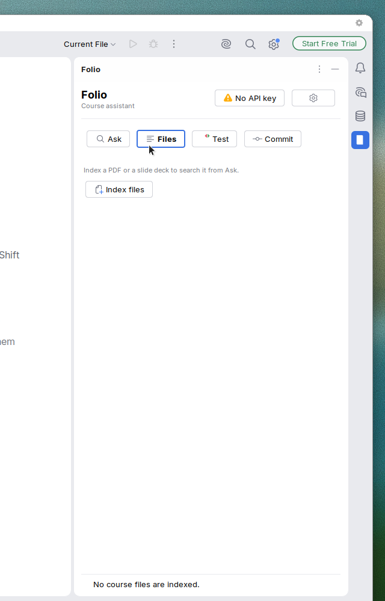
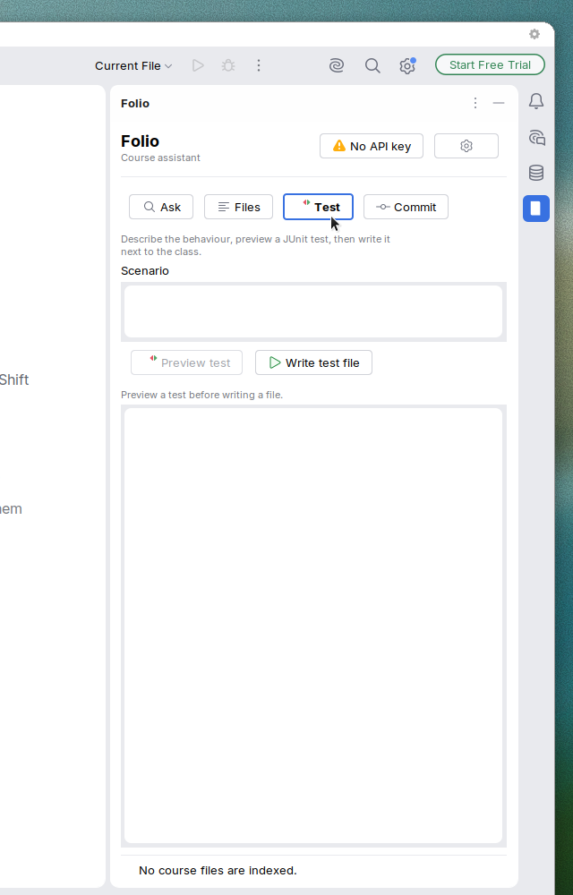
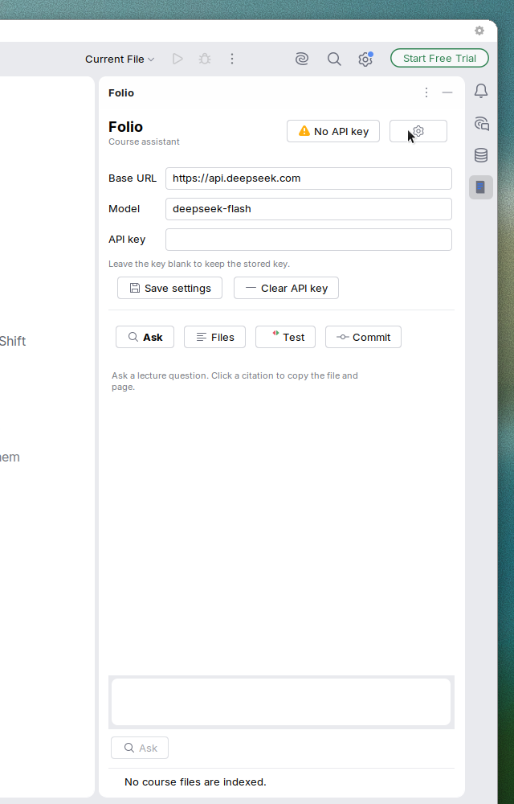
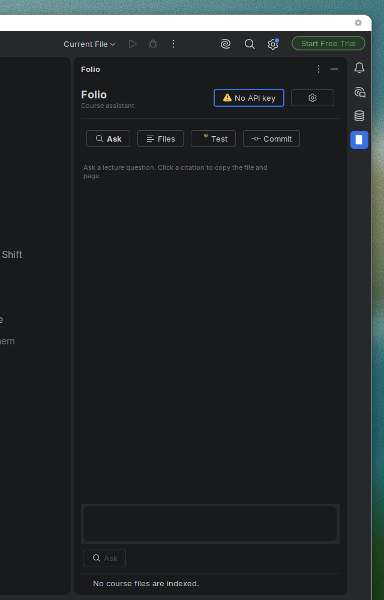
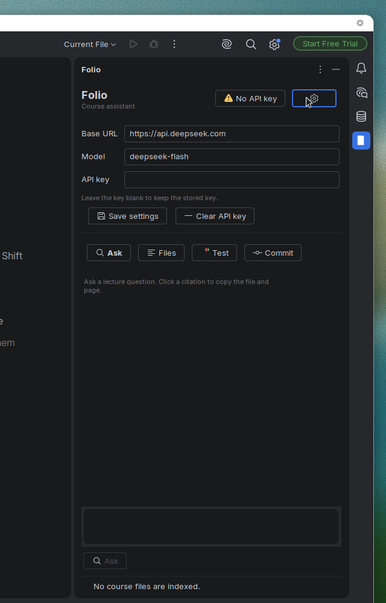
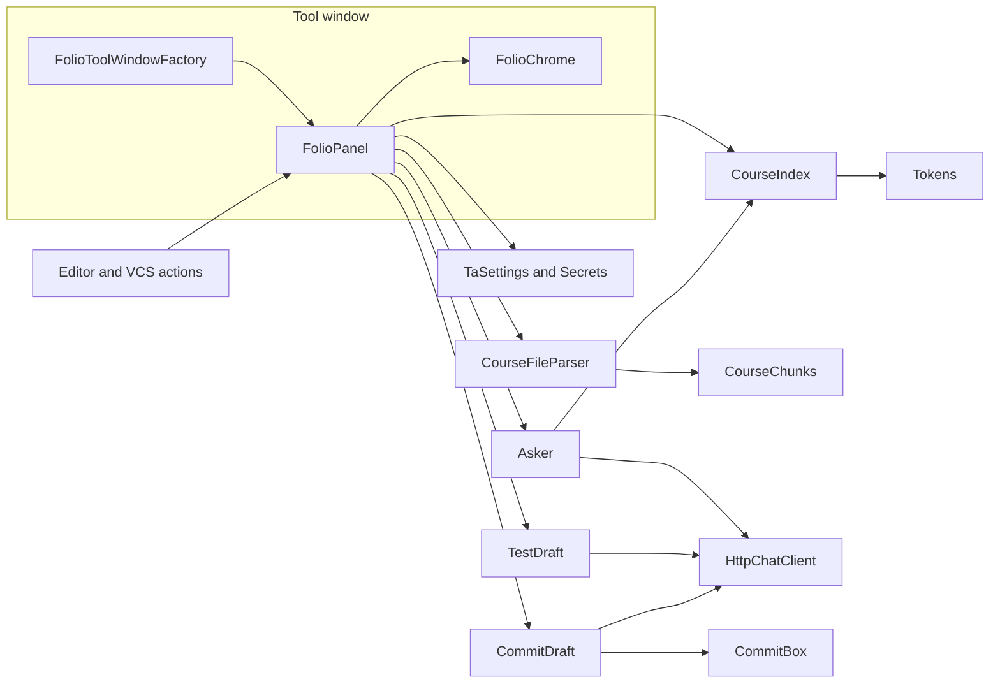
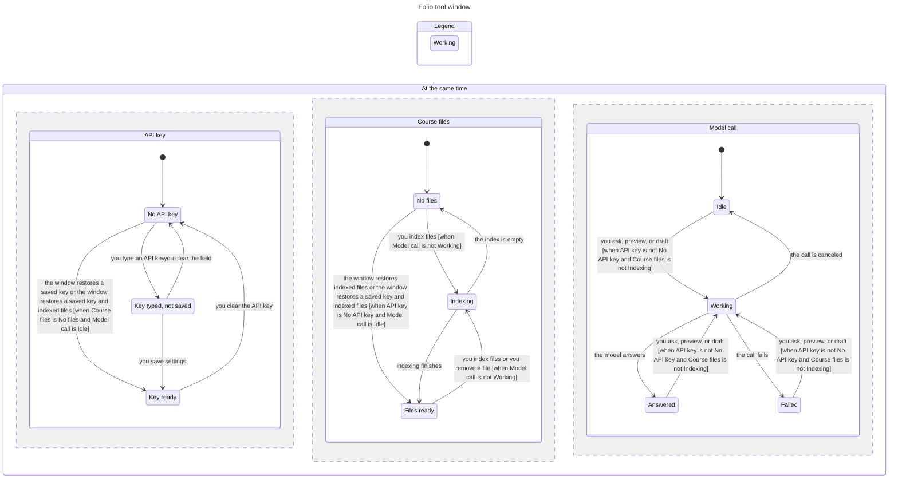
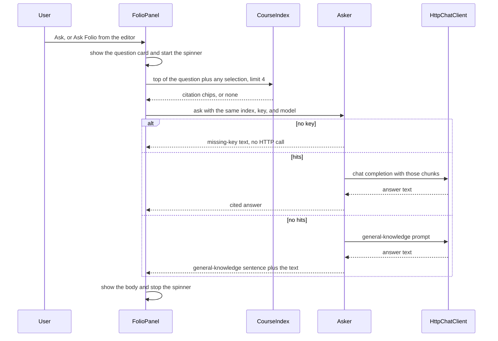

# Folio

Folio is an IntelliJ IDEA plugin for CST3492 Group B. It sits in a tool window and answers questions from the course files the lecturer has indexed. When a chunk of a PDF page or a slide is relevant, the answer cites that file and that page or slide. When nothing in the index is relevant, the answer says so and does not invent a citation.

Group B covers answering from course material and the IDE actions around it: generate a JUnit test, draft a commit message, and run a short course drill. It does not edit the student's code or drive the built-in diff viewer.

Plugin id `cst3492.folio`, version 0.1.0. The tool window is named **Folio**, anchored on the right. The course plan is `docs/course-ta-plugin-plan.md`, with a Chinese copy at `docs/course-ta-plugin-plan.zh.md`.

## Demo story

A twenty-minute demo in a course project:

1. Open **Folio**. The header reads Folio / Course assistant. With no key stored, the badge says **No API key**, and Ask, Preview test, and Draft commit messages are disabled.
2. Open the gear. Set the base URL and model if needed, paste an API key, and choose **Save settings**. The field clears and the badge becomes **Key ready · deepseek-flash**. An empty Save after that keeps the stored key.
3. On **Files**, choose **Index files** and pick a lecture PDF and a slide deck. Each row shows the file name, the directory, and the page or slide count. **Remove** asks before deleting that one path.
4. On **Ask**, type a question about the lecture. Folio shows the question, then citation chips (`lecture-servlet.pdf page 1`, or a slide number for a deck), then the answer. A chip copies the citation. A question that does not match the course shows the general-knowledge sentence and no chips.
5. Put the caret on a method and run **Generate JUnit From Scenario** from the editor menu. The dialog is prefilled with the scenario already in the tool window. **Preview test** fills the preview. **Write test file** writes that preview next to the class.
6. Stage a change and run **Draft Folio Commit Messages** from the commit dialog. Folio drafts three messages, copies the first, and, when the action was started from the commit box, places that first message in the box.

The screenshots below are the tool window in Islands Light and Islands Dark. They are not a recording of that full demo.

## Features

### Ask, with cited pages and slides

The Ask section is a short chat. An empty window shows a one-line hint. Each question is a card; each answer is a card under it. Citation chips are the file name plus `page N` or `slide N`. Clicking a chip copies that line.

Retrieval runs before the model call, and the chips appear as soon as the hits are known. The model then sees those chunks and is told to repeat the path and scope number it uses. At most four chunks are sent.

If the key is missing, Ask does not call the model. The card shows: "No API key is configured. Add an API key in the Folio tool window and save settings." If there were hits, they stay on the card.

If the key is present and there are no hits, the answer starts with: "Response is based on general knowledge; no specific course material is referenced." There are no chips.

**Ask Folio** on the editor popup asks "Explain the selected code." or, with no selection, "Explain this." **Folio Course Drill** asks the model for three short questions about the selection and still cites chunks. With no selection the drill says "Select some code first." and does not call the model.

### Files

**Index files** opens a multi-select file chooser. It does not need an API key. Each file is stored under its absolute path, so two `notes.pdf` files in different directories stay separate. Re-indexing a path replaces that path only.

PDF and other formats Tika can turn into HTML are chunked from `div.page`. PPTX is read with POI so the slide number follows the order shown in the deck, including speaker notes on that slide and excluding the slide master. A page or slide longer than 700 characters is split with a 100-character overlap. The row shows the file name, the parent directory when the source is a path, and the distinct page or slide count plus the chunk count.

**Remove** asks for confirmation, then deletes chunks whose source id is that path.

The index is saved as `index.tsv` under the IDE config directory `folio/`. It is reloaded when the tool window is created.

### Test generation

**Generate JUnit From Scenario** opens a multiline dialog, prefilled with the text already in the Test section. Cancel, or an empty accept, does not generate. A successful accept stores the scenario and starts a preview.

**Preview test** needs a key. The model is asked for one JUnit test class that includes an `org.junit` import. The result is written into the preview area (the same text **Write test file** reads).

**Write test file** stays enabled with no key. It writes the current preview text into a new Java file in the directory of the class or method the editor action captured. The file body is that preview string, not a second model call.

### Commit messages

**Draft commit messages** needs a key, a Git repository, and a non-empty staged diff (`git diff --cached -M`). The diff sent to the model is capped at 12,000 characters, without cutting a UTF-16 surrogate pair. The model is asked for three conventional messages separated by a line that is only `---`.

The tool window shows the bounded diff and the numbered messages. Message 1 is copied to the clipboard. If the action was started from the commit dialog, message 1 is also placed in the commit message box ("Placed message 1 in the commit box and copied it."). From the tool window button, with no commit box attached, the line is "Copied message 1."

## Screenshots

Taken in IntelliJ IDEA 2026.2.4 with the new UI. Islands Light is the light set. Islands Dark is the dark set. The previous single-form window was not re-shot, and there is no screenshot of the Commit section.

Ask, Islands Light:



Files, Islands Light. Indexed files would list under this empty state after **Index files**:



Test, Islands Light. Preview test is disabled until a key is present. Write test file stays enabled:



Settings, Islands Light. The key field is empty because a stored key is not copied back into the form:



Ask, Islands Dark:



Settings, Islands Dark, default model `deepseek-flash`:



## Requirements

- JDK 25. The Gradle build sets source and target to 25.
- IntelliJ IDEA 2026.2. The plugin depends on platform build `262` through `262.*`. The Gradle project resolves IntelliJ IDEA 2026.2.4.
- A DeepSeek-compatible chat endpoint if you want live answers. The default base URL is `https://api.deepseek.com` and the default model id is `deepseek-flash`. `deepseek-v4-pro` is also a current model id on that API. Folio does not change the default.

## Build, run, and test

From the repository root, with JDK 25 on `JAVA_HOME`:

```sh
./gradlew test
./gradlew buildPlugin
./gradlew runIde
```

`test` runs the JUnit 5 suite. `buildPlugin` writes the plugin zip under `build/distributions/`. `runIde` launches a sandbox IDE with Folio installed. Open the tool window from the right stripe or with Find Action. The log line `Folio tool window created` means the factory ran.

`runIde` resolves a Compose hot-reload agent the first time it is not in the Gradle cache, so that task may need network even when `test` and `buildPlugin` run offline.

### Maven Central behind a firewall

`build.gradle.kts` loads Tika, POI, Gson, PDFBox, and JUnit from Maven Central. The IntelliJ Platform plugin adds its own repositories for the IDE itself. Those IDE downloads are separate from Maven Central.

To send Maven Central lookups to a mirror, pass a Gradle init script with `-I`. Keep the script outside this repo and do not commit a machine-specific path. Point the URL at whatever mirror you use:

```sh
./gradlew test buildPlugin -I /path/to/your-mirror.init.gradle
```

```gradle
allprojects {
    repositories {
        maven { url = uri("https://repo.example/maven") }
    }
}
```

Replace `https://repo.example/maven` with the mirror. This does not retarget the JetBrains IDE repositories.

## Configuration

The gear opens a settings card. It starts collapsed. The badge and the gear both toggle it.

| Setting | Where it is stored | Default |
| --- | --- | --- |
| Base URL | IDE application config `folio.xml`, via `TaSettings` | `https://api.deepseek.com` |
| Model | same file | `deepseek-flash` |
| API key | IntelliJ Password Safe, service name Folio / `apiKey` | none |

The key is not written into `folio.xml`. After a successful save the password field is cleared; the secret stays in the Password Safe.

**Save settings** with a non-empty field stores that value and the badge becomes **Key ready**, plus the model name when the model field is not blank. **Save settings** with an empty field does not call the Password Safe. A key that was already stored stays stored, and the status line says the stored key was kept. **Clear API key** is the action that writes an empty secret and returns the badge to **No API key**.

The badge is based on the stored secret, not on characters sitting in the field:

- **No API key** when nothing is stored and the field is empty. Ask, Preview test, and Draft commit messages are disabled. Their tooltip is the missing-key sentence.
- **Key not saved** when the field has characters and nothing is stored yet. Those three buttons are enabled, and a call uses the typed value.
- **Key ready** only when a key is stored. Typing more characters does not change that badge. A call uses the typed characters when the field is non-empty, and the stored secret otherwise.

**Index files** and **Write test file** stay enabled with no key.

## How retrieval works

Indexing and search are local. There is no embedding model.

### Chunks

`CourseChunks` splits each page or slide. A body of at most 700 characters (`MAX_CHARS`) is one chunk. A longer body is cut on a space or newline in the second half of that window, then the next piece starts 100 characters earlier (`OVERLAP`). Cuts are moved so they do not split a UTF-16 surrogate pair. Every piece keeps the original page or slide number. A page with several pieces uses ids ending in `#1`, `#2`, and so on.

### Tokens

English tokens are `[A-Za-z0-9_]+`, lowercased, with a short stop list and a light stem (`sses` to `ss`, `ies` to `y`, a trailing `s` on longer words). `one` and `many` are not stop words, so a query such as `one-to-one` still indexes the word `one`.

Chinese, Japanese, and Korean characters are indexed as overlapping bigrams. A bigram is dropped only when both characters are in the closed-class list in `Tokens` (的, 了, 是, 我, 你, …). A mixed pair such as 并发, 向量, 性能, or 不可变 stays in the index. 我们 and 可以 drop because both characters are grammatical.

### Which chunks are hits

`CourseIndex.top` scores with BM25 (`k1 = 1.2`, `b = 0.75`). The idf term is `ln(1 + (N - df + 0.5) / (df + 0.5))`. Postings are updated when a chunk is added or removed, so a re-index does not rebuild the whole index from scratch.

A score is not enough. The question is split into coverage units, and a chunk must cover at least half of them (`MIN_COVERAGE = 0.5`):

- Each English word that is not in the coverage-skip set is one unit. That set is `confused`, `give`, `simple`, `one`, `many`, `kindly`, `briefly`, `describe`. Those words can still be indexed. They just do not dilute the count. `describe` is also a stop word, so it is not indexed either.
- Chinese is one unit per run of content Han characters, not one unit per bigram. The run is split on punctuation and on function characters. Courtesy phrases are stripped from the run, longest first, and do not add a unit: 能不能, 请问, 详细, 麻烦, 了解, 深入, 一下, 问题, 回事, 到底, 请, 讲, 地, 给. They are not removed from the index, so 请求 and 性能 stay searchable. Single characters 一, 关, 能, and 不 are not fillers, so 一对, 关系, 性能, and 不可变 stay intact.
- If nothing remains (a lone technical word such as 不可变 or 请求), coverage falls back to the indexed terms.

Among chunks that clear the half-coverage bar, Folio keeps those whose score is at least 25% of the best score (`RELATIVE_KEEP = 0.25`) and returns at most four. There is no absolute score floor. A question that shares one common word with the course, or a question about the weather, or an unrelated sentence, comes back with no hits.

## Architecture

### Package map

| Package | Classes | Role |
| --- | --- | --- |
| `cst3492.courseta` | `FolioToolWindowFactory`, `FolioPanels`, `FolioPanel`, `FolioChrome`, `TaSettings`, `Secrets` | Tool window, layout, settings, Password Safe |
| `cst3492.courseta.ask` | `AskAction`, `Asker`, `Answer`, `ChatClient`, `HttpChatClient` | Retrieval-backed answers and the HTTP client |
| `cst3492.courseta.index` | `CourseIndex`, `CourseChunk`, `CourseChunks`, `CourseFileParser`, `Tokens`, `ScopeKind` | Parse, chunk, BM25 |
| `cst3492.courseta.junitgen` | `GenerateTestAction`, `ScenarioDialog`, `Scenario`, `TestDraft` | Scenario dialog, preview, write |
| `cst3492.courseta.commit` | `CommitMessageAction`, `CommitDraft`, `CommitBox`, `GitDiffs` | Staged diff, three messages, commit box |
| `cst3492.courseta.drill` | `CourseDrillAction`, `Drill` | Three questions about the selection |

`FolioPanel` is the behaviour owner. `FolioChrome` is the Swing layout: cards, buttons, the spinner, and the section columns. `FolioPanels` keeps one panel per project in a weak map so the editor actions can find it after the tool window is shown.

### Components



### Tool-window statechart

The chart is the lifecycle a person sees: the API key, the course files, and a model call, side by side. Ask, Preview test, and Draft commit stay off while the badge is **No API key**. Indexing and a model call share the spinner in this chart, and only one of them runs at a time. **Indexing** and **Working** are the states where the spinner is showing.

The checked rules are in `docs/statechart/FolioWindow.tla`. TLC found no break: the three LLM buttons match the key, the spinner is on exactly while a call or indexing is in progress, an empty Save does not drop a stored key, and Write copies the preview text. The chart hides two steps that do not change these three regions: empty Save, and Write test file. Both are still in the spec.



Source files: `docs/statechart/FolioWindow.tla`, `FolioWindow.cfg`, `view.mjs`, and `chart.mmd`.

### Data flow for Ask



`Asker.ask` calls `CourseIndex.top` again with the same limit. The chips and the prompt therefore come from two lookups of the same index. The HTTP client posts JSON to `{baseUrl}/chat/completions` (or to the base URL itself when it already ends in `/chat/completions`) with a bearer token. Timeouts are 20 seconds to connect and 60 seconds for the response. The message content must be a JSON string. A non-2xx status becomes an `IOException` that includes a short piece of the error body. That failure is shown as the answer text, and the spinner stops.

Anything that uses `FolioPanel.run` (Ask, drill, preview, commit draft, index, remove) increments a busy counter on the calling thread and decrements it when the result is delivered. A platform cancellation (`ControlFlowException`, including `ProcessCanceledException`) schedules the same decrement and is rethrown, so the spinner does not stay up.

## Limitations and what was not verified

- No live model call was made for this write-up. Citation chips were not clicked in a running IDE, and the commit box was not filled in a running IDE. The screenshots are from an earlier `runIde` session of this tool window.
- There is no screenshot of Commit, and no dark screenshot of Files or Test.
- The chat keeps every card. There is no clear button and no cap.
- Ask, Preview, and Draft in the tool window are disabled with no key. The editor and VCS actions are not. They still open the tool window and call the panel. With no key, Ask, preview, and the commit draft return the missing-key sentence and do not call HTTP. The spinner still runs for that path and then stops.
- **Write test file** writes the current preview only when a target directory is known and the text is non-blank and contains `org.junit` or the substring `class `. The condition is `isBlank() || !contains("org.junit") && !contains("class ")`, so `&&` is tested before `||`. A refusal replaces the preview with an instruction and does not write a file. The no-directory instruction contains the word "class", so a later Write, once a directory is set and the preview has not been replaced, will treat that sentence as a preview and write it.
- Two `run` calls can overlap. The spinner is a counter, so it stays up until both finish. The statechart serializes them.
- Saving a new key sets the badge to **Key ready** and writes the Password Safe on a background thread. An empty Save does not take that path.
- Indexed files may lie outside the project. Folio does not open them from a citation chip.
- Retrieval is lexical BM25 over the indexed files. It is not a web search and not a vector index.
- The course plan in `docs/course-ta-plugin-plan.md` describes a larger program. This tree is the plugin that program built for Group B, not that program's process.

## Project layout

```
build.gradle.kts          Java 25, IntelliJ 2026.2.4, Tika, POI, Gson
src/main/java/            plugin sources, packages above
src/main/resources/       plugin.xml and the tool-window icons
src/test/java/            JUnit 5
docs/images/              Islands Light and Dark screenshots
docs/statechart/          TLA+ spec, TLC config, view, chart.mmd
docs/course-ta-plugin-plan.md
```

## Testing

`./gradlew test buildPlugin` with JDK 25 completes successfully. The suite is **78 tests, 0 failures**.

| Test class | Tests |
| --- | ---: |
| `CourseIndexTest` | 32 |
| `HttpChatClientTest` | 10 |
| `CommitMessageActionTest` | 9 |
| `FolioPanelTest` | 7 |
| `AskerTest` | 7 |
| `CourseFileParserTest` | 7 |
| `GenerateTestActionTest` | 3 |
| `TaSettingsTest` | 1 |
| `AnswerTest` | 1 |
| `CourseDrillActionTest` | 1 |

The index tests lock the retrieval rules above: weather and unrelated questions return no hits, a lecture term still hits when it appears in every chunk, polite Chinese and English questions still reach the course term, and removing one absolute path leaves another file with the same name. `FolioPanelTest` locks the button gate, empty Save, the badge text, the scaled hint width, and cancellation. `CourseFileParserTest` checks page and slide order and that a chosen source id is stored. The UI tests do not construct a `Project`, so they do not click the confirmation dialog or the live tool window.
