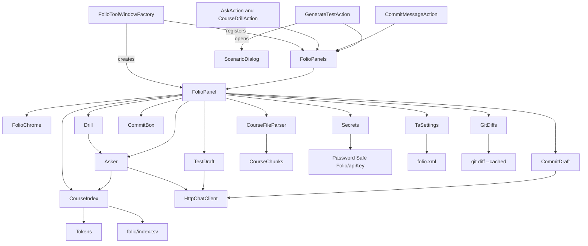
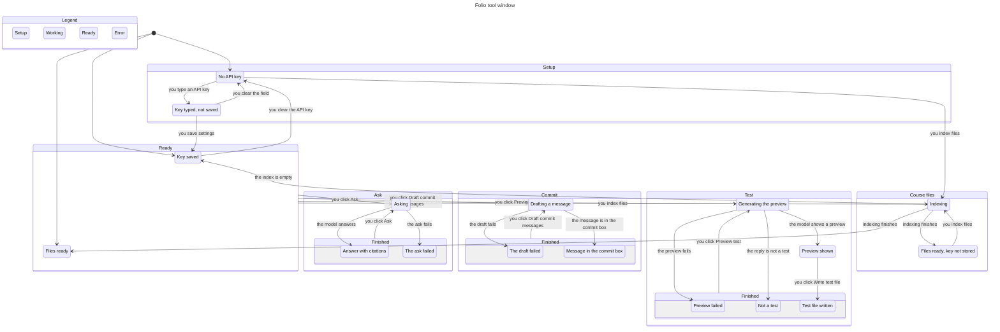
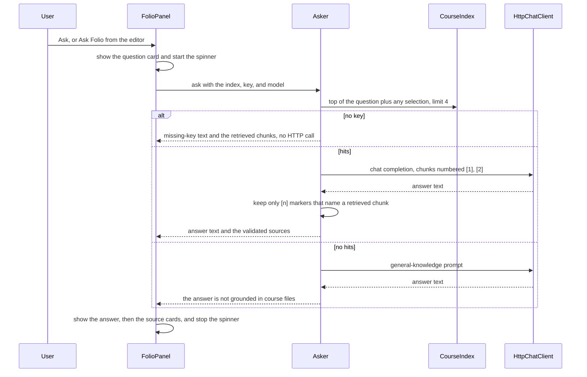

# Folio

Folio is an IntelliJ IDEA plugin for CST3492 Group B. It sits in a tool window and answers questions from the course files the lecturer has indexed. When a retrieved chunk is used, the answer cites it inline as [1], [2] and lists that chunk under the answer. When nothing in the index is relevant, the answer says it is not grounded in course files and does not invent a citation.

Group B covers answering from course material and the IDE actions around it: generate a JUnit test, draft a commit message, and run a short course drill. It does not edit the student's code or drive the built-in diff viewer.

Plugin id `cst3492.folio`, version 0.1.0. The tool window is named **Folio**, anchored on the right. The course plan is `docs/course-ta-plugin-plan.md`, with a Chinese copy at `docs/course-ta-plugin-plan.zh.md`.

## Demo story

A twenty-minute demo in a course project:

1. Open **Folio**. The header reads Folio / Course assistant. With no key stored, the badge says **No API key**, and Ask, Preview test, and Draft commit messages are disabled.
2. Open the gear. Set the base URL and model if needed, paste an API key, and choose **Save settings**. The field clears and the badge becomes **Key ready · deepseek-flash**. An empty Save after that keeps the stored key.
3. On **Files**, choose **Index files** and pick a lecture PDF and a slide deck. Each row shows the file name, the directory, and the page or slide count. **Remove** asks before deleting that path. Re-index and Remove also drop a legacy row stored under the bare file name.
4. On **Ask**, type a question about the lecture. Folio shows the question, then the answer. Under the answer, each source card is a retrieved chunk the reply cited: the file name, the page or slide (and part, when a page was split), and a short excerpt. The numbers match the [1], [2] marks in the answer. Clicking a card opens a text file in the editor at that excerpt, or a preview when the file is a PDF, a slide deck, or not on disk. A question that matches nothing says the answer is not grounded in course files and shows no source cards.
5. Put the caret on a method and run **Generate JUnit From Scenario** from the editor menu. The dialog is prefilled with the scenario already in the tool window. **Preview test** fills the preview. **Write test file** stays off until that preview returns a test, then writes it next to the class. A failed preview, or a reply that is not a test, leaves a note in the preview and does not enable Write.
6. Stage a change and run **Draft Folio Commit Messages** from the commit dialog. Folio drafts three messages, copies the first, and, when the action was started from the commit box, places that first message in the box.

The screenshots below are the tool window in Islands Light and Islands Dark, from before the theme in the next section. They are not a recording of that full demo.

The tool window follows the IDE theme. Cards, the section bar, status banners, and the key badge take their colors from the platform, so the same window is readable in light and dark. Ask, Files, Test, Commit, and Setup are rounded sections. The main action in a section is the platform default button. Empty Ask, Files, and Commit sections say what to do next. A running call, a saved key, a failure, and a successful write each use the platform banner color.

## Features

### Ask, with sources

The Ask section is a short chat. An empty window shows a one-line hint. Each question is a card; each answer is a card under it. Source cards sit under the answer. A card shows `[n]`, the file name, `page N` or `slide N` (plus `part N` when that page or slide was split), and a short excerpt of the chunk.

Retrieval still runs before the model call. At most four chunks are sent. Each one is numbered in the prompt. The model is told to cite those numbers inline as [1], [2], with a space before the bracket, and not to invent a number. Folio then checks the reply:

- A marker is kept only when its number names one of those retrieved chunks. Markers are rewritten so [1], [2] follow the source list under the answer.
- A number that was not retrieved is removed from the text and never becomes a card. Removing one only tidies the space it left. Indexes such as `args[0]` and `m[0][2]`, calls such as `foo()[1]`, assignments such as `x = [1, 2]`, fenced blocks, and inline code are left as written, including their indentation.
- If the reply contains no markers, the source list is the retrieved chunks. The model was given only those chunks and did not name a subset.
- If every marker is out of range, there are no source cards. The card says: "The reply did not cite a retrieved course chunk."

Clicking a source opens that course file. A text file on disk opens in the editor with the caret at the excerpt. A PDF, a slide deck, another non-text file, or a path that is not on disk opens a preview of the indexed chunk instead.

If the key is missing, Ask does not call the model. The card shows: "No API key is configured. Add an API key in the Folio tool window and save settings." If there were hits, those retrieved chunks stay on the card as sources.

If the key is present and no chunk passes the cutoff, the answer starts with: "Response is based on general knowledge; no specific course material is referenced." The card states: "This answer isn't grounded in course files." There are no source cards. A prose [n] the model invents is removed. A list or index in code is not.

**Ask Folio** on the editor popup asks "Explain the selected code." or, with no selection, "Explain this." **Folio Course Drill** asks the model for three short questions about the selection and still cites chunks. With no selection the drill says "Select some code first." and does not call the model.

### Files

**Index files** opens a multi-select file chooser. It does not need an API key. Each file is stored under its absolute path, so two `notes.pdf` files in different directories stay separate. Re-indexing a path replaces that path and also drops a legacy row whose source id is only the file name. Older `index.tsv` files stored that bare name. A second file with the same name in another directory is left in place.

PDF and other formats Tika can turn into HTML are chunked from `div.page`. PPTX is read with POI so the slide number follows the order shown in the deck, including speaker notes on that slide and excluding the slide master. A page or slide longer than 700 characters is split with a 100-character overlap. The row shows the file name, the parent directory when the source is a path, and the distinct page or slide count plus the chunk count.

**Remove** asks for confirmation, then deletes chunks whose source id is that path. Removing a path also deletes the legacy bare-name row for that file name. Removing a row that is already a bare name deletes only that row.

The index is saved as `index.tsv` under the IDE config directory `folio/`. It is reloaded when the tool window is created.

### Test generation

**Generate JUnit From Scenario** opens a multiline dialog, prefilled with the text already in the Test section. Cancel, or an empty accept, does not generate. A successful accept stores the scenario and starts a preview.

**Preview test** needs a key. The model is asked for one JUnit test class that includes an `org.junit` import. The result is written into the preview area. Write turns on only when that reply contains `org.junit` or `class `. A missing scenario, a missing key, a blank reply, an error, or any other reply stays in the preview and leaves Write off. A reply that is not a test is shown under the note "The reply was not a JUnit test."

**Write test file** copies that successful preview into a new Java file in the directory of the class or method the editor action captured. The file body is that preview string, not a second model call. With no directory captured, Write reports that a class or method must be selected and does not replace the preview. Starting another preview turns Write off until the new call succeeds.

### Commit messages

**Draft commit messages** needs a key, a Git repository, and a non-empty staged diff (`git diff --cached -M`). The diff sent to the model is capped at 12,000 characters, without cutting a UTF-16 surrogate pair. The model is asked for three conventional messages separated by a line that is only `---`.

The tool window shows the bounded diff and the numbered messages. Message 1 is copied to the clipboard. If the action was started from the commit dialog, message 1 is also placed in the commit message box ("Placed message 1 in the commit box and copied it."). From the tool window button, with no commit box attached, the line is "Copied message 1."

## Screenshots

Taken in IntelliJ IDEA 2026.2.4 with the new UI, before the theme above. Islands Light is the light set. Islands Dark is the dark set. The previous single-form window was not re-shot, and there is no screenshot of the Commit section. Headless paints of the themed window are not a substitute for these: icon glyphs do not draw without a window.

Ask, Islands Light:


Files, Islands Light. Indexed files would list under this empty state after **Index files**:


Test, Islands Light. This shot is from before Write was tied to a successful preview, so **Write test file** still looks enabled. In the current window it stays disabled until a preview returns a test. Preview test is disabled until a key is present:


Settings, Islands Light. The key field is empty because a stored key is not copied back into the form:


Ask, Islands Dark:


Settings, Islands Dark, default model `deepseek-flash`:


## Requirements

- JDK 25. The Gradle build sets source and target to 25.
- IntelliJ IDEA 2026.2. The plugin depends on platform build `262` through `262.*`. The Gradle project resolves IntelliJ IDEA 2026.2.4.
- A DeepSeek-compatible chat endpoint if you want live answers. The default base URL is `https://api.deepseek.com` and the default model id is `deepseek-flash`. `deepseek-v4-pro` is also a current model id on that API. Folio does not change the default.

## Build, run, and test

From the repository root, with JDK 25 on `JAVA_HOME`:

```sh
./gradlew test
./gradlew buildPlugin
./gradlew runIde
```

`test` runs the JUnit 5 suite. `buildPlugin` writes the plugin zip under `build/distributions/`. `runIde` launches a sandbox IDE with Folio installed. Open the tool window from the right stripe or with Find Action. The log line `Folio tool window created` means the factory ran.

`runIde` resolves a Compose hot-reload agent the first time it is not in the Gradle cache, so that task may need network even when `test` and `buildPlugin` run offline.

### Maven Central behind a firewall

`build.gradle.kts` loads Tika, POI, Gson, PDFBox, and JUnit from Maven Central. The IntelliJ Platform plugin adds its own repositories for the IDE itself. Those IDE downloads are separate from Maven Central.

To send Maven Central lookups to a mirror, pass a Gradle init script with `-I`. Keep the script outside this repo and do not commit a machine-specific path. Point the URL at whatever mirror you use:

```sh
./gradlew test buildPlugin -I /path/to/your-mirror.init.gradle
```

```gradle
allprojects {
    repositories {
        maven { url = uri("https://repo.example/maven") }
    }
}
```

Replace `https://repo.example/maven` with the mirror. This does not retarget the JetBrains IDE repositories.

## Configuration

The gear opens a settings card. It starts collapsed. The badge and the gear both toggle it.

| Setting | Where it is stored | Default |
| --- | --- | --- |
| Base URL | IDE application config `folio.xml`, via `TaSettings` | `https://api.deepseek.com` |
| Model | same file | `deepseek-flash` |
| API key | IntelliJ Password Safe, service name Folio / `apiKey` | none |

The key is not written into `folio.xml`. After a successful save the password field is cleared; the secret stays in the Password Safe.

**Save settings** with a non-empty field stores that value and the badge becomes **Key ready**, plus the model name when the model field is not blank. **Save settings** with an empty field does not call the Password Safe. A key that was already stored stays stored, and the status line says the stored key was kept. **Clear API key** is the action that writes an empty secret and returns the badge to **No API key**.

The badge is based on the stored secret, not on characters sitting in the field:

- **No API key** when nothing is stored and the field is empty. Ask, Preview test, and Draft commit messages are disabled. Their tooltip is the missing-key sentence.
- **Key not saved** when the field has characters and nothing is stored yet. Those three buttons are enabled, and a call uses the typed value.
- **Key ready** only when a key is stored. Typing more characters does not change that badge. A call uses the typed characters when the field is non-empty, and the stored secret otherwise.

**Index files** stays enabled with no key. **Write test file** stays off until a preview returns a JUnit test.

## How retrieval works

Indexing and search are local. There is no embedding model.

### Chunks

`CourseChunks` splits each page or slide. A body of at most 700 characters (`MAX_CHARS`) is one chunk. A longer body is cut on a space or newline in the second half of that window, then the next piece starts 100 characters earlier (`OVERLAP`). Cuts are moved so they do not split a UTF-16 surrogate pair. Every piece keeps the original page or slide number. A page with several pieces uses ids ending in `#1`, `#2`, and so on.

### Tokens

English tokens are `[A-Za-z0-9_]+`, lowercased, with a short stop list and a light stem (`sses` to `ss`, `ies` to `y`, a trailing `s` on longer words). `one` and `many` are not stop words, so a query such as `one-to-one` still indexes the word `one`.

Chinese, Japanese, and Korean characters are indexed as overlapping bigrams. A bigram is dropped only when both characters are in the closed-class list in `Tokens` (的, 了, 是, 我, 你, …). A mixed pair such as 并发, 向量, 性能, or 不可变 stays in the index. 我们 and 可以 drop because both characters are grammatical.

### Which chunks are hits

`CourseIndex.top` scores with BM25 (`k1 = 1.2`, `b = 0.75`). The idf term is `ln(1 + (N - df + 0.5) / (df + 0.5))`. Postings are updated when a chunk is added or removed, so a re-index does not rebuild the whole index from scratch.

A score is not enough. The question is split into coverage units, and a chunk must cover at least half of them (`MIN_COVERAGE = 0.5`):

- Each English word that is not in the coverage-skip set is one unit. That set is `confused`, `give`, `simple`, `one`, `many`, `kindly`, `briefly`, `describe`. Those words can still be indexed. They just do not dilute the count. `describe` is also a stop word, so it is not indexed either.
- Chinese is one unit per run of content Han characters, not one unit per bigram. The run is split on punctuation and on function characters. Courtesy phrases are stripped from the run, longest first, and do not add a unit: 能不能, 请问, 详细, 麻烦, 了解, 深入, 一下, 问题, 回事, 到底, 请, 讲, 地, 给. They are not removed from the index, so 请求 and 性能 stay searchable. Single characters 一, 关, 能, and 不 are not fillers, so 一对, 关系, 性能, and 不可变 stay intact.
- If nothing remains (a lone technical word such as 不可变 or 请求), coverage falls back to the indexed terms.

Among chunks that clear the half-coverage bar, Folio keeps those whose score is at least 25% of the best score (`RELATIVE_KEEP = 0.25`) and returns at most four. There is no absolute score floor. A question that shares one common word with the course, or a question about the weather, or an unrelated sentence, comes back with no hits.

## Architecture

### Package map

| Package | Classes | Role |
| --- | --- | --- |
| `cst3492.courseta` | `FolioToolWindowFactory`, `FolioPanels`, `FolioPanel`, `FolioChrome`, `TaSettings`, `Secrets` | Tool window, layout, settings, Password Safe |
| `cst3492.courseta.ask` | `AskAction`, `Asker`, `Answer`, `ChatClient`, `HttpChatClient` | Retrieval-backed answers and the HTTP client |
| `cst3492.courseta.index` | `CourseIndex`, `CourseChunk`, `CourseChunks`, `CourseFileParser`, `Tokens`, `ScopeKind` | Parse, chunk, BM25 |
| `cst3492.courseta.junitgen` | `GenerateTestAction`, `ScenarioDialog`, `Scenario`, `TestDraft` | Scenario dialog, preview, write |
| `cst3492.courseta.commit` | `CommitMessageAction`, `CommitDraft`, `CommitBox`, `GitDiffs` | Staged diff, three messages, commit box |
| `cst3492.courseta.drill` | `CourseDrillAction`, `Drill` | Three questions about the selection |

`FolioPanel` is the behaviour owner. `FolioChrome` is the Swing layout: cards, the section bar, banners, buttons, and the empty states. Only `FolioPanel` uses it. `ScenarioDialog` is in another package and styles itself with the same platform colors. `FolioToolWindowFactory` builds the panel and registers it in `FolioPanels`, one panel per project. Editor and VCS actions do not call the factory. They activate the Folio tool window, then take the panel from `FolioPanels`.

### Components

Read the picture from the top, then left to right. UI is teal, services are blue, retrieval is orange, storage is tan, and the HTTP client is purple. The same colors flip for a dark page.

`FolioToolWindowFactory` creates `FolioPanel` and registers it. Ask, drill, generate-test, and the commit action look the panel up in `FolioPanels`. Generate test also opens `ScenarioDialog`. The dialog does not call the panel. The action copies the scenario onto the panel after the dialog closes.

`FolioPanel` calls the services under it. `Drill` calls `Asker`, and does not call HTTP itself. `Asker`, `TestDraft`, and `CommitDraft` call `HttpChatClient`. The panel fills `CommitBox` and reads `GitDiffs`. `CommitDraft` does neither.

The panel parses files with `CourseFileParser`, which splits them through `CourseChunks`. `CourseIndex` stores and scores the chunks and asks `Tokens` for terms. It does not parse files. `Asker` calls `CourseIndex` as well. The index file is `folio/index.tsv` under the IDE config directory. The API key is Password Safe service `Folio/apiKey`. Base URL and model are `folio.xml` via `TaSettings`. The staged diff is `git diff --cached`.


<details>
<summary>Component diagram source</summary>



</details>

### Tool-window statechart

The chart is the path a person walks, not three dials side by side. Read it from the top.

There are three places to start, drawn as arrows from the black dot. A fresh window starts at **No API key**. Opening the window again can start at **Key saved** or at **Files ready**, which is the saved key and the saved index. There is no restore arrow.

**Setup** is tan: type a key, clear the field, or save it. **Ready** is where the saved key waits, with or without course files. **Course files** holds **Indexing** and **Files ready, key not stored**. Index files does not need a key, so that last box is tan. From Ready the four buttons diverge: **you click Ask**, **you click Preview test**, **you click Draft commit messages**, and **you index files**. Ask, Test, and Commit are separate boxes. **Finished** inside each box is an outcome. The arrow out of Finished is that same button again. **Preview shown** sits next to Finished because **you click Write test file** is a different step. **Preview failed** and **Not a test** are inside Finished and have no Write arrow.

Color is the phase. Tan is setup, before a key is saved, including files that were indexed with no stored key. Orange is the spinner: indexing, asking, generating a preview, or drafting. Teal is a saved key, files ready, or a successful result. Pink is a failed ask, preview, or draft, or a reply that is not a test.

The checked rules are in `docs/statechart/FolioWindow.tla`. TLC reached 102 states and 502 steps and found no break. The chart draws 17 states and 24 arrows. Twenty-one of those arrows are the saved-key path. The other three are indexing with no stored key: **you index files** from **No API key**, **indexing finishes** into **Files ready, key not stored**, and **you index files** again from that box.

- The Ask, Preview, and Draft buttons are enabled exactly when a key is typed or stored.
- A running call was started with a typed or stored key.
- The spinner is on exactly while a call or indexing is in progress.
- An empty Save does not drop a stored key.
- Write copies the transcript only after the last preview returned a test, so a failed preview and a prose reply are not the test file.

The chart hides steps that repeat a drawn arrow or that do not change the box you are looking at. They are still in the spec.

- Empty Save, and Write again after the file is already written. The box does not change.
- Remove a file. It enters Indexing the same way as indexing again.
- Ask, Preview, and Draft while the key is typed but not saved, including when files are already indexed. The buttons do turn on. The chart shows those clicks after Save, from Ready.
- From a finished Ask, Test, or Commit, the other features' buttons, and indexing. The chart draws only the same button again.
- From Preview shown, another Ask, Preview, or Draft. The drawn step is Write.
- Clearing the key, clearing the field, or saving, when you do that from a result rather than from Setup or Key saved.
- Saving a key that was only typed while files were already indexed. That reaches **Files ready**.
- Indexing while a key is typed but not saved. The chart draws indexing from **No API key** and from a saved key.
- An empty index when no key is stored. That returns to **No API key**, or to **Key typed, not saved** if a key was typed. The drawn empty-index arrow returns only to **Key saved**.
- Typing a key while files are ready. The box stays **Files ready, key not stored**.

The model runs one activity at a time. The panel's spinner is a busy counter, so two `run` calls can overlap and the spinner stays up until both finish. The model also leaves out the editor and VCS actions. They can still call the panel when the tool-window buttons are off. With no key they return the missing-key sentence and do not call HTTP, but the spinner still runs. It leaves out changing the key while a call is already running. Clear is only allowed at a hub. If it were allowed mid-call, `rest` would end the call, and TLC would not report it. The window lets that call finish. It leaves out cancelling a call, `showNote` (an empty scenario from the editor, or an index error), and the target directory. A reply that is not a test is a state. Write in the model assumes a directory is known. The panel also refuses when the editor action never set one. Clearing the key after files are indexed is left out. The window allows it, and the files stay. Starting Ask, Preview, or Draft clears the test transcript in the model. The panel keeps the previous preview on screen until that call returns. Chat cards and the wording of a commit message are not states. The chart's "message in the commit box" is only that the draft succeeded.



<details>
<summary>Statechart source</summary>



</details>

Source files: `docs/statechart/FolioWindow.tla`, `FolioWindow.cfg`, `view.mjs`, `chart.mmd`, and `chart.svg`. `view.mjs` supplies the labels, the groups, and the colors. `chart.mmd` is regenerated from the spec and that view with the statechart script (`scripts/statechart FolioWindow.tla --view view.mjs --out DIR`, with mise on `PATH`). `chart.svg` is that Mermaid rendered with pele 1.9.0 (`limit` 1000000, `outputLimit` 8000000, `maxEdges` 10000) and the statechart colors inlined. The component picture is `docs/images/components.svg`. It is the same graph as the mermaid above it, laid out by hand in those colors so the five layers read on a page. `classDef` is not used for the layer colors, because a `classDef` fill is painted as an inline style and a dark page cannot restyle it.

### Data flow for Ask



`Asker.ask` calls `CourseIndex.top` once. The prompt and the source cards come from that lookup, after citation markers are checked. The HTTP client posts JSON to `{baseUrl}/chat/completions` (or to the base URL itself when it already ends in `/chat/completions`) with a bearer token. Timeouts are 20 seconds to connect and 60 seconds for the response. The message content must be a JSON string. A non-2xx status becomes an `IOException` that includes a short piece of the error body. That failure is shown as the answer text, and the spinner stops.

Anything that uses `FolioPanel.run` (Ask, drill, preview, commit draft, index, remove) increments a busy counter on the calling thread and decrements it when the result is delivered. A platform cancellation (`ControlFlowException`, including `ProcessCanceledException`) schedules the same decrement and is rethrown, so the spinner does not stay up.

## Limitations and what was not verified

- No live model call was made for this write-up. Source cards were not clicked in a running IDE, and the commit box was not filled in a running IDE. The Islands screenshots are from an earlier `runIde` session, before the theme. A headless paint of the themed panel exists for Ask, Files, Test, and Setup in light and dark, and a headless paint of an answer with source cards. Icon glyphs do not draw in that paint.
- There is no Islands screenshot of Commit, and no Islands dark screenshot of Files or Test.
- The chat keeps every card. There is no clear button and no cap.
- Ask, Preview, and Draft in the tool window are disabled with no key. The editor and VCS actions are not. They still open the tool window and call the panel. With no key, Ask, preview, and the commit draft return the missing-key sentence and do not call HTTP. The spinner still runs for that path and then stops.
- **Write test file** turns on only when the last preview call succeeded and the reply contains `org.junit` or `class `. That check is only on the model reply. Failure text is shown as it is and does not enable Write, even when it contains those words. A reply that is not a test is shown with the note "The reply was not a JUnit test." and Write stays off. The no-directory sentence is a status line. It does not replace the preview, so it is not written.
- Two `run` calls can overlap. The spinner is a counter, so it stays up until both finish. The statechart serializes them.
- Saving a new key sets the badge to **Key ready** and then writes the Password Safe on a background thread. If that write fails, the badge still says **Key ready**. An empty Save does not take that path.
- A source card opens a text file that is on disk in the editor, at the excerpt. A PDF, a slide deck, or a path that is not on disk opens a preview of the indexed chunk. That open path was not exercised in a running IDE.
- Retrieval is lexical BM25 over the indexed files. It is not a web search and not a vector index.
- The course plan in `docs/course-ta-plugin-plan.md` describes a larger program. This tree is the plugin that program built for Group B, not that program's process.

## Project layout

```
build.gradle.kts          Java 25, IntelliJ 2026.2.4, Tika, POI, Gson
src/main/java/            plugin sources, packages above
src/main/resources/       plugin.xml and the tool-window icons
src/test/java/            JUnit 5
docs/images/              Islands screenshots and the component diagram
docs/statechart/          TLA+ spec, TLC config, view, chart.mmd, chart.svg
docs/course-ta-plugin-plan.md
```

## Testing

`./gradlew test buildPlugin` with JDK 25 completes successfully. The suite is **94 tests, 0 failures**.

| Test class | Tests |
| --- | ---: |
| `CourseIndexTest` | 33 |
| `HttpChatClientTest` | 10 |
| `CommitMessageActionTest` | 9 |
| `FolioPanelTest` | 10 |
| `AskerTest` | 19 |
| `CourseFileParserTest` | 7 |
| `GenerateTestActionTest` | 3 |
| `TaSettingsTest` | 1 |
| `AnswerTest` | 1 |
| `CourseDrillActionTest` | 1 |

`AskerTest` locks citation mapping: prose `[n]` markers are renumbered onto retrieved chunks, unknown numbers are dropped, and code spans, fences, indexes, and indentation stay as written. An empty retrieval says the answer is not grounded and still leaves a code list alone. The index tests lock the retrieval rules above: weather and unrelated questions return no hits, a lecture term still hits when it appears in every chunk, polite Chinese and English questions still reach the course term, and removing one absolute path leaves another file with the same name. They also load a legacy bare-name row: re-indexing the same handout drops that row, and Remove drops it too. `FolioPanelTest` locks the button gate, empty Save, the badge text, the scaled hint width, cancellation, and that Write copies a preview only after it succeeded. A prose reply leaves Write off. Error text that contains `class ` or `org.junit` does not enable Write either. `CourseFileParserTest` checks page and slide order and that a chosen source id is stored. The UI tests do not construct a `Project`, so they do not click the confirmation dialog or the live tool window.
